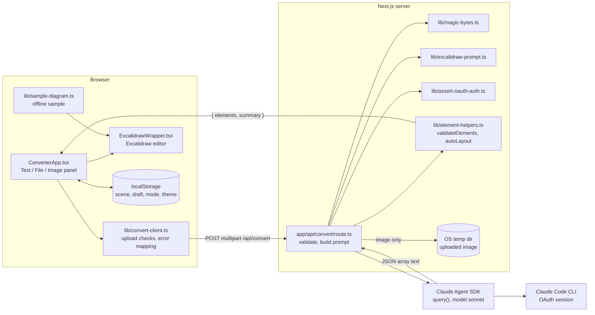

# Excalidraw Converter

Turn text, text files, and images into editable Excalidraw diagrams with Claude.
Live interface: [excalidraw-converter.vercel.app](https://excalidraw-converter.vercel.app) (see the hosted-demo note below).

[](https://github.com/cskwork/excalidraw-converter/actions/workflows/ci.yml)
[](LICENSE)

> **Hosted demo note.** Conversion runs through the Claude Agent SDK, which signs in with the
> Claude Code CLI session of the machine running the server. The Vercel deployment has no such
> session, so its `/api/convert` returns HTTP 500 (checked 2026-10-28). The hosted site shows the
> interface, the editor, and a built-in sample diagram; run it locally to convert your own input.

## Problem

Drawing a diagram by hand means placing shapes, labelling them, and wiring arrows, even when the
content already exists as notes, a Markdown file, or a whiteboard photo. This app sends that input
to Claude, gets back native Excalidraw elements (shapes, bound text, arrows), checks them on the
server, and drops them into a real Excalidraw editor where every element can still be moved,
restyled, or exported.

## Architecture



The full component breakdown, data flow, and failure handling are in
[docs/architecture.md](docs/architecture.md).

## Key technical decisions

- **No API key; the server borrows the local Claude Code session.** `src/lib/assert-oauth-auth.ts`
  refuses to run if `ANTHROPIC_API_KEY` is set, so the Agent SDK always uses Claude Code's OAuth
  login and no key ever exists in the app, the browser, or the deployment.
  Trade-off: the hosted demo cannot convert. [ADR 0001](docs/adr/0001-claude-code-oauth-instead-of-api-key.md)
- **The model writes Excalidraw JSON; the server does not trust it.** `src/lib/excalidraw-prompt.ts`
  gives the element schema and layout rules; `src/app/api/convert/route.ts` pulls the JSON array out
  of the reply (fenced or bare), and `src/lib/element-helpers.ts` drops elements without a known
  type, id, x, and y, renames duplicate ids, fills defaults, and re-grids shapes that overlap.
  [ADR 0002](docs/adr/0002-model-emits-excalidraw-json-server-validates.md)
- **Uploads are treated as untrusted.** Image bytes are checked against the declared MIME type
  (`src/lib/magic-bytes.ts`), the temp file name comes from the MIME type rather than the user's file
  name, text is wrapped in `<user_content>` with an instruction not to follow it, and the agent runs
  one turn with only the `Read` tool (images only) and a `maxBudgetUsd: 0.25` cap.
  [ADR 0003](docs/adr/0003-untrusted-input-handling.md)
- **Failures map to messages a user can act on.** `src/lib/convert-client.ts` turns a generic 5xx
  into "the engine isn't reachable, run locally or load the sample", and separates input errors,
  timeouts, cancellations, and network errors. The client aborts at 130 s, just after the server's
  120 s race in `route.ts`.

## Run locally

Prerequisites: Node.js 18.18+ (CI uses Node 20) and the
[Claude Code CLI](https://docs.anthropic.com/en/docs/claude-code), signed in. Make sure
`ANTHROPIC_API_KEY` is **not** set in the server's environment.

```bash
git clone https://github.com/cskwork/excalidraw-converter.git
cd excalidraw-converter
npm ci
npm run dev        # http://localhost:3000
```

`./start.sh` installs dependencies if needed and starts the dev server; `./start.sh prod` builds and
runs the production server.

Limits enforced by the API route: text up to 100,000 characters (longer text is truncated), files and
images up to 10 MB; images must be PNG, JPEG, GIF, or WebP; documents `.txt .md .json .csv .xml .html`.

## Testing

Run on 2026-10-28 (macOS, Node 22.19.0), same commands as CI:

| Command | Result |
|---------|--------|
| `npx tsc --noEmit` | no errors |
| `npx eslint . --max-warnings 0` | no issues |
| `npm run test:coverage` (Vitest, 8 files) | **174 passed, 0 failed, 0 skipped**; `src/lib` coverage 99.51% statements, 97.79% branches |
| `npx playwright test` (Chromium, 7 specs) | **41 passed, 0 failed, 0 skipped** |
| `npm run build` | succeeds |

Unit tests cover `src/lib/*` and the `/api/convert` route with the Agent SDK mocked
(`src/app/api/convert/__tests__/route.test.ts`). The Playwright specs start `npm run dev` and stub
`/api/convert` with `page.route`, so neither suite calls Claude.

CI (`.github/workflows/ci.yml`) runs these on every push and pull request to `main`.

## Limitations and next steps

- The hosted deployment cannot convert (no Claude Code session there). Making it work would need a
  server-side API key or another hosted model, which ADR 0001 deliberately avoids.
- `/api/convert` has no requester authentication or rate limiting; it relies on running locally.
- When `autoLayout` re-grids overlapping shapes it moves shapes and their bound text, but not arrows,
  so arrows can point at old positions until edited.
- No streaming: the user waits for the whole reply (up to 120 s).

## Fixed on this branch

- The upload panel accepts `.xml` and `.html` and upper-case extensions, but the API only accepted
  four lower-case extensions plus a MIME list without `text/xml`, so a `.xml` file or `NOTES.MD`
  sent with an empty MIME type got HTTP 415. The route now reuses the panel's `DOCUMENT_EXTENSIONS`
  case-insensitively and accepts `text/xml`.
- The CI lint job had failed on every run because ESLint 9 found no `eslint.config.*`; added the
  Next.js flat config.

## Scripts

| Command | Description |
|---------|-------------|
| `npm run dev` | Start development server |
| `npm run build` | Production build |
| `npm run start` | Start production server |
| `npm run lint` | Run ESLint (`next lint`) |
| `npm test` | Run unit tests (Vitest) |
| `npm run test:watch` | Run tests in watch mode |
| `npm run test:coverage` | Unit tests with coverage (80% thresholds on `src/lib`) |

## More docs

- [docs/architecture.md](docs/architecture.md): components, data flow, failure handling
- [docs/adr/](docs/adr/): architecture decision records
- [PRODUCT.md](PRODUCT.md) and [DESIGN.md](DESIGN.md): product brief and visual design system
- [docs/asset-register.md](docs/asset-register.md): origin of shipped images
- [docs/production-readiness-report-2026-03-31.md](docs/production-readiness-report-2026-03-31.md): earlier review (historical)
- [CONTRIBUTING.md](CONTRIBUTING.md)

## License

MIT, see [LICENSE](LICENSE).
