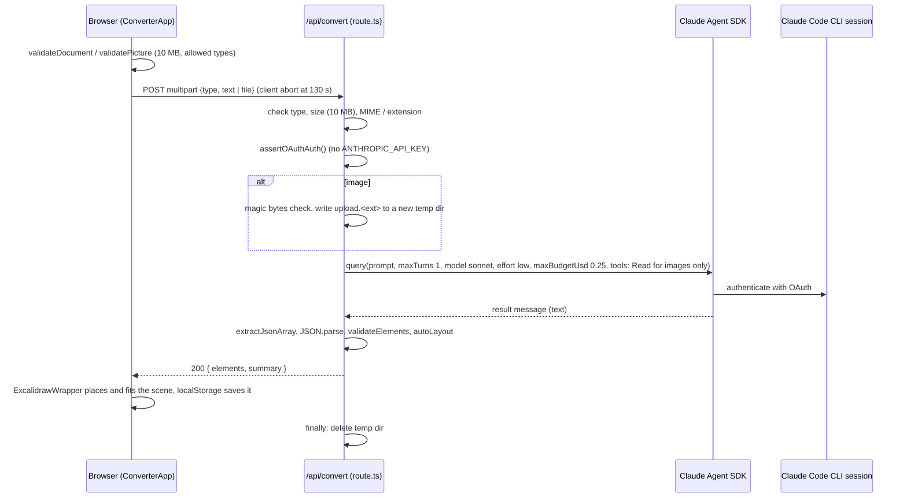

# Architecture

Excalidraw Converter is a single Next.js 15 (App Router) app. The browser holds the input panel
and the Excalidraw editor; one API route turns the input into Excalidraw elements by calling Claude
through the Claude Agent SDK. There is no database and no user account; the browser's
localStorage keeps the session.

## Components

| Component | Path | Responsibility |
|-----------|------|----------------|
| Page shell | `src/app/page.tsx`, `src/app/layout.tsx` | Renders `ConverterApp`; metadata and icons |
| Converter UI | `src/components/ConverterApp.tsx` | Text / File / Image modes, Convert and Cancel, status window, theme, resizable panel, mobile panel/canvas switch, localStorage persistence |
| Input widgets | `src/components/TextInput.tsx`, `FileUpload.tsx`, `ImageUpload.tsx`, `DropBay.tsx` | Text area and drag-and-drop bays; run client-side upload checks before anything is sent |
| Status window | `src/components/StatusWindow.tsx` | Elapsed clock, result summary, error message |
| Editor | `src/components/ExcalidrawWrapper.tsx` | Loads `@excalidraw/excalidraw` client-only (`next/dynamic`), places each new scene once per request (`nonce`), fits it to the viewport, and defers the fit if the canvas is hidden (mobile) |
| Client helpers | `src/lib/convert-client.ts` | `validateDocument` / `validatePicture`, `describeHttpFailure` / `describeThrownFailure`, scene counting, formatting |
| Sample diagram | `src/lib/sample-diagram.ts` | Builds an Excalidraw skeleton that the browser converts with `convertToExcalidrawElements`; works with no server call |
| API route | `src/app/api/convert/route.ts` | Parses multipart form data, validates it, builds the prompt, calls the Agent SDK with a timeout, extracts and validates the JSON, returns `{ elements, summary }` |
| Prompt | `src/lib/excalidraw-prompt.ts` | Element schema, layout rules, and a strategy per input type (text, file, image) |
| Auth guard | `src/lib/assert-oauth-auth.ts` | Throws if `ANTHROPIC_API_KEY` is set, so the SDK only uses the Claude Code OAuth session |
| Upload check | `src/lib/magic-bytes.ts` | Confirms PNG / JPEG / GIF / WebP signatures match the declared MIME type |
| Element helpers | `src/lib/element-helpers.ts` | `validateElements` (filter, dedupe ids, defaults), `autoLayout` (re-grid overlapping shapes), element factories |
| Logger | `src/lib/logger.ts` | One-line JSON logs with a per-request `requestId` |

## Data flow (one conversion)



1. The user picks a mode and provides text (sent as is), a document, or an image. The browser checks
   size and type first (`src/lib/convert-client.ts`).
2. `route.ts` re-checks everything server-side: `type` must be `text`, `file`, or `image`; text must
   not be blank; files must be at most 10 MB; images must be PNG, JPEG, GIF, or WebP; documents must
   have an allowed MIME type or one of the panel's extensions (`.txt .md .json .csv .xml .html`,
   case-insensitive).
3. Text and document content longer than 100,000 characters is truncated, then wrapped in
   `<user_content>` with a note that it is data, not instructions. Images are written to a fresh
   `mkdtemp` directory under a MIME-derived name, and the prompt asks the agent to `Read` that path.
4. The SDK call races a 120 s timer (`maxDuration = 150` for the route on Vercel).
5. The reply is parsed: a fenced ```json block first, otherwise the outermost `[...]`. Elements
   without a known type (`rectangle ellipse diamond text arrow line`), string id, and numeric x/y are
   dropped; duplicate ids get new ones; missing style fields get defaults. If any two shapes overlap,
   shapes are re-placed on a grid (360 x 230 cells) and their bound text follows.
6. The browser places the elements in the editor and saves the scene to localStorage (debounced
   400 ms); the text draft, input mode, and theme are saved as they change.

## External dependencies

| Dependency | Use |
|------------|-----|
| `@anthropic-ai/claude-agent-sdk` | `query()` runs Claude through the locally installed, signed-in Claude Code CLI |
| `@excalidraw/excalidraw` | Editor component and `convertToExcalidrawElements` for the sample |
| `next`, `react`, `react-dom` | App Router, API route, UI |
| `lucide-react` | Icons |
| Tailwind CSS | Styling |
| Vitest + jsdom, Playwright | Unit and end-to-end tests |

## Failure handling

| Failure | Where | Response the user sees |
|---------|-------|------------------------|
| Bad form data, unknown type, blank text, missing file | `route.ts` | 400 with the specific message |
| File over 10 MB | `route.ts` (and client first) | 413 |
| Unsupported image or document type | `route.ts` (and client first) | 415 |
| Image bytes don't match the declared type | `route.ts` + `magic-bytes.ts` | 400 "File content does not match declared type" |
| `ANTHROPIC_API_KEY` set, or Claude Code not available | `assertOAuthAuth`, SDK | 500 "Internal server error" (details only in the server log); the client shows "engine isn't reachable, run locally or load the sample" |
| Agent returns an error result, no result, or times out (120 s) | `route.ts` | 502 with the reason |
| Reply isn't a JSON array, or has no valid elements | `route.ts` | 502 |
| Client gives up at 130 s, user cancels, network down | `convert-client.ts` | Timeout, cancelled, or network message |
| localStorage full or blocked | `ConverterApp.tsx` | Ignored; the session simply isn't restored |

Known gaps: the 120 s race returns an error to the user but does not abort the SDK query itself (the
per-request `maxBudgetUsd: 0.25` cap bounds its cost); the endpoint has no requester authentication
or rate limiting; `autoLayout` does not move arrows when it re-grids shapes.

## Deployment

`main` deploys to Vercel from git. On Vercel there is no Claude Code session, so conversion returns
500 and the UI offers the sample diagram instead (see ADR 0001). CI (`.github/workflows/ci.yml`)
runs typecheck, lint, unit tests with coverage, Playwright, and a production build.
